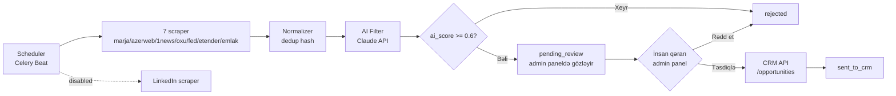
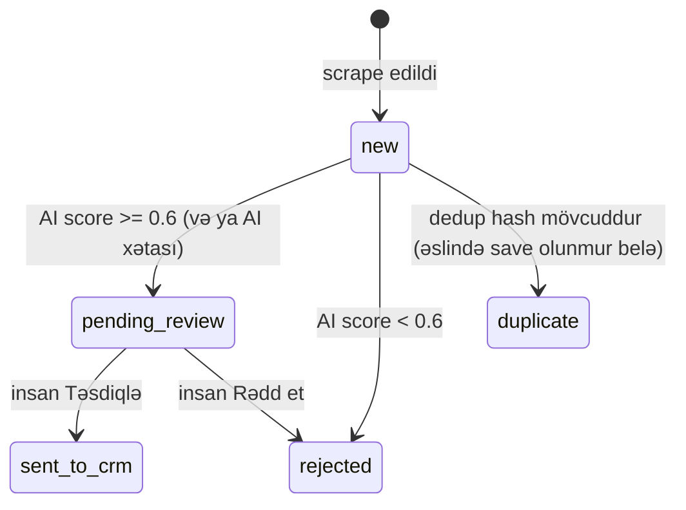

# 02 — Architecture

## Diaqram

## Komponentlər və fayllar

| Komponent | Fayl | Məsuliyyət |
| --- | --- | --- |
| Data modeli | [`app/models.py`](../../app/models.py) | `RawLead`, enum-lar, dedup hash |
| Scraper-lar | [`app/scrapers/`](../../app/scrapers) | Hər mənbə üçün ayrıca sinif, ortaq `BaseScraper` |
| Normalizer | [`app/normalizer.py`](../../app/normalizer.py) | Dublikat yoxlaması (DB-yə əsaslanan) |
| AI Filter | [`app/ai_filter.py`](../../app/ai_filter.py) | Claude API ilə skorlama, fail-safe (xəta → `pending_review`, YOX `rejected`) |
| CRM Client | [`app/crm_client.py`](../../app/crm_client.py) | `/opportunities` POST sorğusu |
| Pipeline | [`app/pipeline.py`](../../app/pipeline.py) | Yuxarıdakıları bir-birinə bağlayan orkestrator |
| DB qatı | [`app/db/`](../../app/db) | SQLAlchemy modeli + repository (CRUD, status keçidləri) |
| Admin panel | [`app/web.py`](../../app/web.py) + [`app/templates/`](../../app/templates) | Manual scrape tetiklənməsi, validasiya UI |
| Scheduler | [`app/scheduler.py`](../../app/scheduler.py) | Celery Beat cədvəli (production, avtomatik rejim) |

## İki işləmə rejimi

1. **Manual/test rejimi** — admin panel (`uvicorn app.web:app`), "Scrape indi" düyməsi `run_pipeline()`-i sinxron çağırır, SQLite DB.
2. **Production rejimi** — Celery worker + Beat, `app/scheduler.py`-dəki cədvəllə avtomatik işləyir, Postgres DB.

Hər ikisi **eyni** `run_pipeline()` funksiyasından istifadə edir (`app/pipeline.py`) — məntiq təkrarlanmır.

## Status maşını (`LeadStatus`)

**Vacib qərar:** AI heç vaxt birbaşa `sent_to_crm`-ə keçmir — yalnız insan bunu edə bilər (bax `04-decisions.md` → Human-in-the-loop).

## Data axını nümunəsi

1. `scrape_source("etender")` çağırılır (admin panel düyməsi və ya Celery task)
2. `EtenderScraper.fetch_leads()` → real API-dən `RawLead` siyahısı
3. `Normalizer.process()` → dedup hash yoxlanılır, yeni olanlar DB-yə yazılır
4. `AIFilter.score_batch()` → Claude API çağırılır, `ai_score`/`ai_reason` təyin olunur
5. Repository yenilənir, status `pending_review` və ya `rejected`
6. Admin panel `/leads/pending_review`-də insan görür, Təsdiqlə/Rədd et
7. Təsdiqlənərsə → `CRMClient.create_opportunity()` → status `sent_to_crm`
