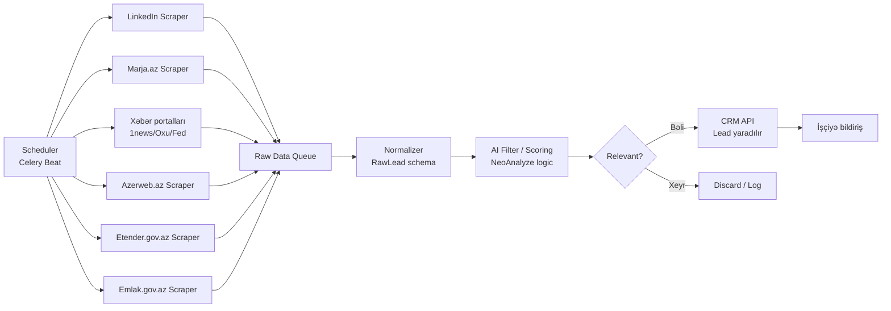

# Lead Scraping — Development Spec (Python)

*22 Sentyabr 2026*

## 1. Overview

Bu sənəd catering şirkəti üçün **lead scraping** modulunun development spesifikasiyasıdır. Modulun məqsədi — internetdə (LinkedIn, xəbər portalları, tender platformaları, elan saytları) potensial müştəriləri (tədbir, banket, korporativ catering ehtiyacı olan şəxs/şirkətlər) avtomatik aşkarlamaq, filtrləmək və CRM-ə "potensial lead" kimi təqdim etməkdir.

Bu modul NeoAI konsepsiyasının bir hissəsi kimi işləyir: fasiləsiz arxa plan skanı aparır, uyğun fürsət tapdıqda CRM-də avtomatik task/lead yaradır və məsul işçiyə bildiriş göndərir. Nəticə işçiyə belə təqdim olunur: "Bu sizin üçün potensial müştəri ola bilər."

**Əsas prinsip:** sistem qərar vermir, yalnız aşkarlayır və təqdim edir — yekun qiymətləndirmə və əlaqə saxlama insan tərəfindən edilir (human-in-the-loop).

## 2. Scope — Scraping ediləcək mənbələr

| Mənbə | Tip | Hədəf məlumat | Çətinlik |
| --- | --- | --- | --- |
| LinkedIn | Peşəkar şəbəkə | Şirkət səhifələri, HR/event elanları, işə qəbul postları (tədbir işarəsi) | Yüksək — anti-bot, login tələb olunur, ToS riski |
| Marja.az | Elan/klassifayd | Biznes, tədbir, kirayə elanları | Orta |
| 1news.az | Xəbər portalı | Korporativ tədbir, konfrans, biznes xəbərləri | Aşağı-Orta |
| Oxu.az | Xəbər portalı | İctimai tədbir, korporativ xəbər elanları | Aşağı-Orta |
| Azerweb.az | Elan/xidmət platforması | Biznes elanları, tədbir xidmətləri | Orta |
| Fed.az | Xəbər/analitika | Biznes, sənaye xəbərləri | Aşağı-Orta |
| Etender.gov.az | Dövlət satınalma portalı | Catering/tədbir təchizatı tenderləri | Orta — struktur dəyişə bilər |
| Emlak.gov.az | Dövlət əmlak portalı | Yeni obyekt, ofis, kommersiya sahəsi qeydiyyatı (yeni açılan biznes izi) | Orta — rəsmi format |

Hər mənbə üçün ayrıca **scraper modulu** yazılır (bax §5); nəticələr vahid `RawLead` formatına normalizasiya olunur (bax §4).

> **Qeyd (2026-09-22 tarixindən sonra kodda aparılan real yoxlama):** brauzerlə birbaşa yoxlanılanda bir neçə mənbənin real strukturu yuxarıdakı ilkin fərziyyədən fərqli çıxdı — konkret detallar `app/scrapers/` altındakı hər faylın başındakı şərhlərdədir:
> - **Marja.az** elan saytı deyil, iqtisadi/biznes **xəbər saytı**dır.
> - **Azerweb.az** "İş elanları, Tenderlər və Təhsil" platformasıdır (React SPA + real JSON API, `q=` axtarış dəstəkləyir).
> - **1news.az, Oxu.az, Fed.az**-da RSS feed yoxdur — statik HTML, konkret CSS seçicilər tələb olunur.
> - **Etender.gov.az**-da real JSON API var (`Keyword=` axtarışı ilə).
> - **Emlak.gov.az**-da "yeni obyekt qeydiyyatı" reyestri yoxdur; əvəzinə xəbər/hərrac lenti aşağı-prioritetli siqnal kimi istifadə olunur.
>
> Kod bu real strukturlara uyğun yazılıb və hər scraper canlı sayta qarşı test edilib.

## 3. Architecture

Modul mikroservis kimi qurulur: hər mənbə üçün ayrıca scraper, ortaq bir normalizasiya/filtr qatı və CRM-ə çıxış.

**Komponentlər:**
- **Scheduler** — hər scraper-i müəyyən intervalla işə salır (bax §7)
- **Scraper-lar** — sayt-spesifik, bir-birindən asılı olmayan modullar; biri sınarsa digərləri davam edir
- **Raw Data Queue** — mesaj növbəsi (m. Redis/RabbitMQ), scraper və emal qatını ayırır
- **Normalizer** — hər mənbənin fərqli formatını vahid `RawLead` schema-sına salır
- **AI Filter/Scoring** — catering ehtiyacına uyğunluğu qiymətləndirir, aşağı skorluları atır
- **CRM API inteqrasiyası** — uyğun lead-ləri CRM-də task/opportunity kimi yaradır

## 4. Data Model — `RawLead`

Hər scraper bu vahid formatda nəticə qaytarır:

| Sahə | Tip | Təsvir |
| --- | --- | --- |
| `source` | string | Mənbə adı (`linkedin`, `marja`, `1news`, `oxu`, `azerweb`, `fed`, `etender`, `emlak`) |
| `source_url` | string | Orijinal səhifə linki |
| `title` | string | Elan/post/tender başlığı |
| `raw_text` | text | Təmizlənməmiş mətn (AI filtr üçün) |
| `entity_name` | string \| null | Şirkət/təşkilat adı (tapılıbsa) |
| `contact_info` | object \| null | Telefon, email, sayt (tapılıbsa) |
| `category` | enum | `event`, `corporate`, `tender`, `real_estate`, `other` |
| `location` | string \| null | Şəhər/rayon |
| `posted_at` | datetime \| null | Elanın dərc tarixi |
| `scraped_at` | datetime | Scrape olunma vaxtı |
| `ai_score` | float | 0–1 arası, catering ehtiyacına uyğunluq skoru |
| `ai_reason` | string | AI-nın skor üçün qısa əsaslandırması |
| `status` | enum | `new`, `pending_review`, `sent_to_crm`, `rejected`, `duplicate` |

**Deduplication:** `source` + `source_url` üzrə hash yoxlanılır ki, eyni elan təkrar CRM-ə getməsin.

## 5. Per-site scraping notes

**LinkedIn**
- Rəsmi API (LinkedIn Marketing/Sales Navigator API) icazə və partnyorluq tələb edir; açıq scraping ToS-u pozur və hesab bloklanma riski yaradır.
- Tövsiyə: development komandası əvvəlcə **rəsmi API / lisenziyalı data provider** (m. Proxycurl, Phantombuster kimi 3-cü tərəf xidmətlər) variantlarını qiymətləndirsin. Birbaşa HTML scraping yalnız hüquq şöbəsinin təsdiqi ilə aparılsın. *(Kodda `app/scrapers/linkedin.py` bilərəkdən boş stub olaraq qalıb və scheduler-ə qoşulmayıb.)*

**Marja.az, Azerweb.az**
- Real yoxlamada: Marja.az xəbər saytı (statik HTML, məqalə linkləri `/<id>/<slug>` formatında); Azerweb.az React SPA + JSON API (`/api/announcements/?q=<söz>&type=tender`).
- Hər ikisi işlək scraper kimi yazılıb və test edilib.

**1news.az, Oxu.az, Fed.az** (xəbər portalları)
- RSS feed mövcud deyil (yoxlanıldı) — statik HTML-dən CSS seçicilərlə çıxarılır.
- Açar sözlərlə filtrasiya: "tədbir", "konfrans", "açılış", "korporativ", "banket" və s.
- Fed.az və Oxu.az-da hreflər **nisbidir** — mütləq URL-ə çevrilməlidir (kodda düzəldilib).

**Etender.gov.az** (dövlət satınalma)
- Real JSON API tapılıb: `/api/events?Keyword=<söz>` server-side axtarış dəstəkləyir.
- Detay səhifəsi: `/main/competition/detail/<eventId>`.

**Emlak.gov.az** (dövlət əmlak)
- "Yeni obyekt qeydiyyatı" reyestri yoxdur; sayt əslində "Əmlak Məsələləri Dövlət Xidməti"-dir.
- Real siqnal: "Xəbərlər" və "Hərraclar" bölməsi (hərrac, müsabiqə, obyekt satışı) — aşağı-prioritetli, dolayı siqnal kimi istifadə olunur.

**Ümumi qeydlər**
- `robots.txt` və hər saytın istifadə şərtləri development başlamazdan əvvəl hüquq şöbəsi ilə yoxlanılmalıdır (bax §7).
- Anti-bot müdafiəsi olan saytlarda rotasiya edilən proxy və user-agent istifadəsi nəzərdə tutulsun, lakin bu yalnız icazə verilən hallarda.

## 6. Lead scoring & AI filtering

Ham scrape olunan məlumat həcmcə böyük və çoxu əlaqəsiz olacaq. AI qatı (NeoAnalyze məntiqi ilə uyğun) hər `RawLead`-i qiymətləndirir:

1. **Keyword/kateqoriya filtri** — catering ehtiyacına potensial işarə edən sözlər ("tədbir", "banket", "açılış", "konfrans", "korporativ nəhar", "ictimai iaşə" və s.)
2. **LLM-əsaslı qiymətləndirmə** — `raw_text` LLM-ə veriləərk 0–1 arası `ai_score` və qısa `ai_reason` alınır ("Bu, 200 nəfərlik korporativ açılış tədbiridir, catering ehtiyacı yüksək ehtimallıdır")
3. **Eşik dəyəri** — m. `ai_score >= 0.6` olanlar **insan yoxlaması üçün** (`pending_review`) qeyd olunur, qalanlar `rejected` statusuna düşür
4. **Duplicate yoxlaması** — §4-dəki hash məntiqi ilə

**Human-in-the-loop:** AI heç vaxt avtomatik CRM-ə göndərmir. `pending_review` statusundakı lead-lər admin paneldə insan tərəfindən **Təsdiqlə → CRM** və ya **Rədd et** ilə emal olunur (bax `app/web.py`, `app/pipeline.py`). AI xidməti əlçatan olmasa belə (m. API key yoxdursa) lead səssizcə silinmir — `pending_review`-a düşür ki, insan əl ilə baxsın.

## 7. Scheduling, rate limiting & hüquqi uyğunluq

**Scheduling**
- Xəbər/elan saytları (1news, Oxu, Fed, Marja, Azerweb): hər 1–2 saatdan bir
- Etender.gov.az, Emlak.gov.az: gündə 1 dəfə (yeni elanlar az tezliklə gəlir)
- LinkedIn: yalnız rəsmi/lisenziyalı yanaşma təsdiqləndikdən sonra, məhdud tezliklə

**Rate limiting və texniki qaydalar**
- Hər saytda `robots.txt`-a və elan olunmuş rate-limit-lərə əməl edilir
- Sorğular arası gecikdirmə (2–5 saniyə random jitter) və exponential backoff xətalarda
- Hər scraper üçün ayrıca User-Agent və əlaqə email-i (şəffaflıq üçün)

**Hüquqi/uyğunluq (development başlamazdan əvvəl təsdiqlənməlidir)**
- Hər saytın istifadə şərtləri (ToS) hüquq müşaviri tərəfindən nəzərdən keçirilməlidir — xüsusilə LinkedIn və dövlət portalları (Etender, Emlak)
- Yalnız ictimai/açıq görünən məlumat scrape olunur; şəxsi/gizli məlumat toplanmır
- Şəxsi data qoruma qanunvericiliyinə (fərdi məlumatlar haqqında qanun) uyğunluq tələb olunur

> **Açıq sual (həll tələb edir):** LinkedIn scraping üçün rəsmi API/3-cü tərəf data provider istifadə olunacaqmı, yoxsa bu mənbə ilk MVP-dən çıxarılacaq?

## 8. Tech stack (Python)

| Qat | Alət/Kitabxana | Məqsəd |
| --- | --- | --- |
| HTTP/parsing | `httpx` + `BeautifulSoup4` | Statik HTML saytlar (Marja, 1news, Oxu, Fed) |
| JSON API-lər | `httpx` (birbaşa) | Azerweb.az, Etender.gov.az (real API tapılıb) |
| Browser avtomatlaşdırma | `Playwright` | JS-rendered səhifələr, login tələb edən hallar (ehtiyat variant) |
| Task queue / scheduling | `Celery` + `Redis` və `Celery Beat` | Scraper-lərin dövri işə salınması |
| Data validasiya | `Pydantic` | `RawLead` schema-sının təyini və validasiyası |
| AI qiymətləndirmə | Claude API (Anthropic) | Skoru və əsaslandırmanı hesablamaq |
| Veriلənlər bazası | SQLite (development) / `PostgreSQL` (production) + `SQLAlchemy` | Raw və emal olunmuş lead-lərin saxlanması |
| Admin panel | `FastAPI` + `Jinja2` | Manual scrape tetikləmə + validasiya UI (`app/web.py`) |
| Monitorinq/log | `structlog` | Xətaların izlənməsi |
| CRM inteqrasiyası | Daxili CRM REST API (bax §9) | Lead-lərin CRM-ə ötürülməsi |

Hər scraper ayrıca Docker konteynerində işləyə bilər ki, bir saytın strukturu dəyişəndə digərləri təsirlənməsin.

## 9. CRM inteqrasiyası

AI filtrindən keçən (və insan tərəfindən təsdiqlənən) hər lead CRM-in `Opportunities` (və ya `Leads`) bölməsinə REST API vasitəsilə göndərilir:

- **Endpoint:** `POST /api/opportunities` (CRM komandası ilə dəqiqləşdirilməlidir)
- **Payload:** `entity_name`, `source`, `source_url`, `category`, `ai_score`, `ai_reason`, `contact_info`, `location`
- **Task avtomatik yaradılması:** CRM tərəfindən uyğun satış/menecerinə task təyin edilir, deadline qoyulur və bildiriş gedir
- **Status geri bildirim:** işçi lead-i "qazanıldı"/"rədd edildi" kimi işarələdikdə, bu nəticə gələcəkdə AI skorlama modelinin təkmilləşdirilməsi (feedback loop) üçün saxlanılır

> **Açıq sual:** CRM API-nin dəqiq endpoint və autentifikasiya (API key / OAuth) detalları CRM development komandası ilə ayrıca dəqiqləşdirilməlidir. Hazırkı kodda `CRM_BASE_URL` placeholder ünvandır (`app/crm_client.py`) — real endpoint təyin olunana qədər "Təsdiqlə → CRM" əməliyyatı aydın xəta mesajı ilə uğursuz olur (səssizcə uğurlu görünmür).

## 10. Milestones

| Mərhələ | İş | Nəticə |
| --- | --- | --- |
| 1 | Arxitektura + `RawLead` schema-nın təsdiqi, hüquqi yoxlama (ToS, robots.txt) | Texniki və hüquqi əsas hazır |
| 2 | MVP scraper-lər: Marja.az, Azerweb.az, xəbər portalları (1news, Oxu, Fed) | **Tamamlandı** — 6 mənbədən ham data axır, canlı sayta qarşı test edilib |
| 3 | Etender.gov.az və Emlak.gov.az scraper-ləri | **Tamamlandı** — 8 mənbə tam əhatə olunub (LinkedIn istisna) |
| 4 | AI scoring/filtering qatının inteqrasiyası | **Tamamlandı** — human-in-the-loop ilə (`pending_review`) |
| 5 | CRM API inteqrasiyası və end-to-end test | Kod hazır, real CRM endpoint gözlənilir (§9 açıq sual) |
| 6 | Admin panel (manual test üçün) | **Tamamlandı** — Dashboard + Validasiya UI (`app/web.py`) |
| 7 | LinkedIn həlli (rəsmi API/provider qərarından asılı) | Gözləmədə — §7 açıq sual |
| 8 | Monitorinq, alerting, production-a keçid | Planlaşdırılır |

İlk 6 mərhələ tamamlanıb və test edilib; LinkedIn və real CRM endpoint-i hüquqi/əməliyyat qərarı gözləyir.

---

*Bu sənəd əvvəlcə [Claude Docs](https://claude.ai/code/artifact/bf60eaf0-8d39-447d-8138-fa2f6558a7ff)-da canlı olaraq hazırlanıb, sonra layihə qovluğuna Markdown kimi ixrac edilib. Ən son canlı versiya üçün yuxarıdakı linkə bax.*
